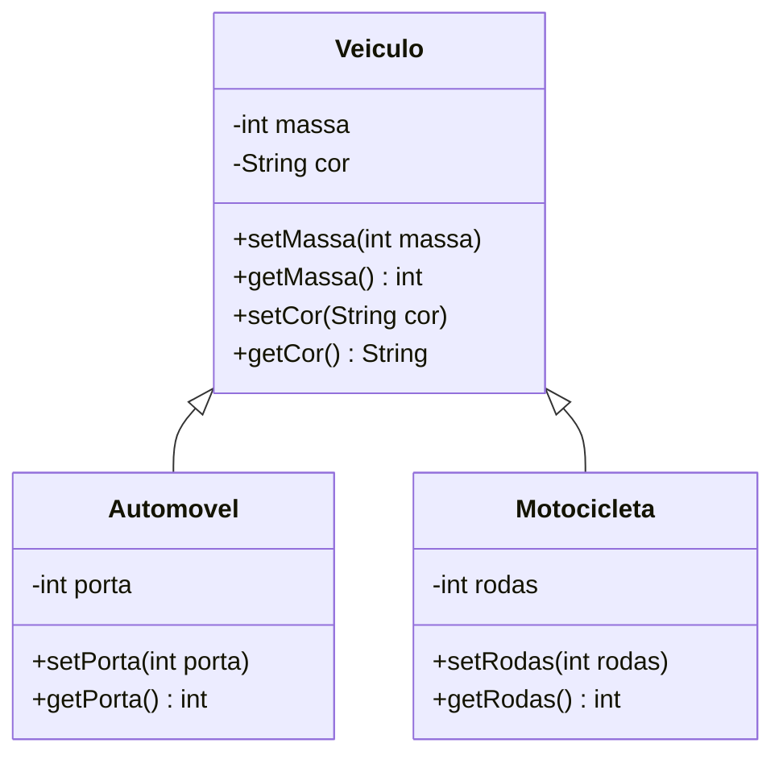

# 🚗🏍️ POO em Java — Herança com Veículos

Projeto prático da disciplina **Programação Orientada a Objeto**, do curso de **Engenharia da Computação** da **Universidade Veiga de Almeida (UVA)**.

O objetivo é praticar os pilares básicos da orientação a objetos em Java: **classes, objetos, encapsulamento e herança**, partindo de um diagrama de classes UML até a implementação e execução do código.

---

## 📚 Sobre o projeto

O trabalho foi dividido em duas práticas:

| Prática | Descrição |
|---------|-----------|
| **Prática 1** | Criação de um diagrama de classes UML |
| **Prática 2** | Implementação do diagrama em código Java |

A ideia central é uma classe genérica **`Veiculo`**, da qual herdam duas classes mais específicas: **`Automovel`** e **`Motocicleta`**.

---

## 🧩 Diagrama de classes



---

## 🛠️ Conceitos aplicados

- **Classe e objeto** — cada veículo (Opala, Fusca, Yamaha...) é uma instância de uma classe.
- **Encapsulamento** — atributos `private`, acessados somente por métodos `get` e `set`.
- **Herança** — `Automovel` e `Motocicleta` usam `extends Veiculo` e reaproveitam `massa` e `cor`.
- **Reuso de código** — atributos comuns ficam na superclasse; os específicos, nas subclasses.

---

## 📁 Estrutura do repositório

```
poo-veiculos/
├── src/
│   ├── Veiculo.java        # Superclasse (massa, cor)
│   ├── Automovel.java      # Subclasse (porta)
│   ├── Motocicleta.java    # Subclasse (rodas)
│   └── MyClass.java        # Classe principal (main)
└── README.md
```

---

## 💻 Classes

### `Veiculo.java`
Superclasse com os atributos comuns a qualquer veículo: `massa` (int) e `cor` (String).

### `Automovel.java`
Estende `Veiculo` e adiciona o atributo `porta` (int).

### `Motocicleta.java`
Estende `Veiculo` e adiciona o atributo `rodas` (int).

### `MyClass.java`
Contém o método `main`. Nela são criados:

- **3 automóveis:** Opala, Fusca e Brasília
- **3 motocicletas:** Royal Enfield, Kawasaki e Yamaha

Para cada objeto, os dados são definidos com os `set` e exibidos com os `get`.

---

## ▶️ Como executar

**Pré-requisito:** ter o [JDK](https://www.oracle.com/java/technologies/downloads/) instalado (versão 8 ou superior).

```bash
# 1. Clone o repositório
git clone https://github.com/SEU-USUARIO/poo-veiculos.git
cd poo-veiculos/src

# 2. Compile
javac *.java

# 3. Execute
java MyClass
```

---

## 🖥️ Resultado esperado

```
Opala
Massa=2000
Cor=Azul
Porta=4
Fusca
Massa=3000
Cor=Vermelho
Porta=4
Brasilia
Massa=2500
Cor=Amarelo
Porta=2
Royal Enfield
Massa=200
Cor=Preta
Rodas=2
Kawasaki
Massa=180
Cor=Verde
Rodas=2
Yamaha
Massa=220
Cor=Azul
Rodas=2
```

---

## 🚀 Possíveis melhorias

- Adicionar **construtores** para criar objetos já com os valores preenchidos
- Usar um **array ou `ArrayList`** para percorrer os veículos com um laço, evitando repetição
- Sobrescrever o método `toString()` para facilitar a impressão
- Criar mais subclasses (ex.: `Caminhao`, `Bicicleta`)
- Aplicar **polimorfismo** com um método `exibirDados()` em cada classe

---

## 👩‍💻 Autora

**Alice de Lima Barbosa**
Estudante de Engenharia da Computação — Universidade Veiga de Almeida
Rio de Janeiro, 2026

---

> Projeto desenvolvido para fins acadêmicos.
